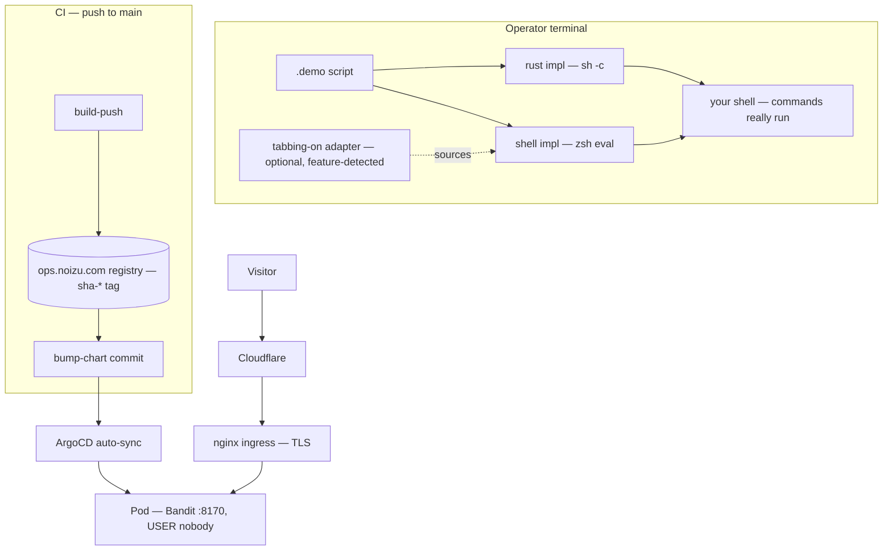

# Project Architecture

## Overview

demo-runner is a typewriter-style scripted terminal demo player: a `.demo`
text file is played back like a human operator — `#`/`##` headings appear
instantly, `$ command` lines are typed character-by-character and then
actually executed, and `@`-directives add pauses, simulated input, prompts,
and screen clears.

The repo carries three cooperating artifacts:

1. **Two demo-player implementations** of one script format — `shell/`
   (zsh, the reference) and `rust/` (a leaner standalone port, not yet at
   full parity). Their behavioral contract is pinned by `contract-tests/`.
2. **A server-rendered landing site** (`web/`) — Elixir/Phoenix/Hologram,
   no DB, no auth, one page plus a health endpoint.
3. **The ship path** — a helm chart and GitHub Actions CI that build the
   site image, push it as `sha-*` on `main`, bump the chart tag, and let
   ArgoCD sync it to the cluster.

## System Diagram

## Core Components

| Component | Purpose |
|---|---|
| `shell/bin/demo-runner` | Reference player: `.demo` grammar, speed control, optional tabbing-on integration, `--reset-state` (opt-in destructive wipe) |
| `rust/src/demo.rs` | Port: same line grammar via `classify_line`, executes via `sh -c` (exit status ignored), `@speed` inline directive, unit-tested |
| `contract-tests/` | One fixture corpus asserted identically against both implementations in an `env -i` sandbox; pins the `--reset-state` safety contract |
| `web/` (Hologram site) | Landing page (`/`, SSR-only) + `GET /healthz` liveness probe |
| `helm/demo-runner-site/` | Deployment + service + ingress into the `apps` namespace; TLS via `therrobotlives-com-tls`; Cloudflare-only ingress |
| CI (`.github/workflows/ci.yml`) | Tool tests + web tests + image smoke on every push; image publish + chart bump only on `main` |

→ *Components ↔ directories: see [PROJ-LAYOUT.md](PROJ-LAYOUT.md)*

## Data Flow

A `.demo` line hits a prefix classifier — `##` before `#`, then `$`,
`@sleep`/`@input`/`@prompt`/`@clear`/`@speed`, blank, verbatim — the same
order in both implementations (mirrored by unit + contract tests). `$`
commands are typed to the terminal for show, then genuinely executed: the
shell impl `eval`s in the current zsh (functions/aliases available,
`set -e` aborts on failure); the rust impl spawns `sh -c` (fresh process,
exit status ignored). The site is stateless SSR: Phoenix serves
`/healthz` and static assets; the Hologram router (mounted before the
Phoenix router) serves `/`.

## Key Decisions

- **Reference + port, pinned by contract tests** — the zsh implementation
  defines behavior; the shared fixture corpus keeps the rust port honest,
  and deliberate deltas live in the README parity matrix.
- **`--reset-state` is opt-in** — upstream tabbing-on's runner wiped the
  tabbing state dir on every invocation; here the wipe runs only behind
  `--reset-state` (integration mode), prints the path first, honors
  `--dry-run`, and has a regression guard. See
  [THREAT-MODEL.md](THREAT-MODEL.md) (T-002).
- **Rust is std-only** — zero crates; typing jitter comes from a tiny
  local xorshift, not a rand dependency.
- **Sessionless landing site** — no DB, no auth, no user state; the cookie
  session plug exists for framework defaults, and the dev
  `secret_key_base` is a documented committed default rotated via env in
  prod.
- **Chart tags are CI-owned** — humans/agents never bump `values.yaml`
  image tags; `bump-chart` commits them on `main` and ArgoCD syncs.

## Release Path

PRs target `develop`; releases flow `develop` → `stage` → `main` as
regular merge commits. A `main` push publishes
`ops.noizu.com/demo-runner.therrobotlives.com/web:sha-<7>` and commits the
chart tag bump (`[skip ci]`); ArgoCD auto-syncs the chart into the
cluster.
