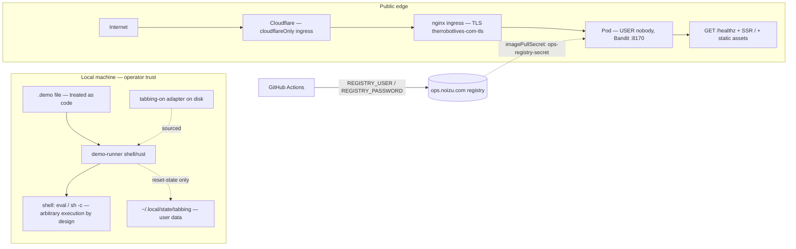

# Threat Model

Security entry point for demo-runner. The repo has two very different
surfaces: a **local CLI that executes shell commands by design**, and a
**public, stateless landing site**. The crown jewels are small and
concrete: the user's tabbing-on state directory (the only thing this tool
can ever destroy) and the availability of the landing page.

→ *Grounding: [PROJ-ARCH.md](PROJ-ARCH.md) · directories:
[PROJ-LAYOUT.md](PROJ-LAYOUT.md) · data surfaces:
[PROJ-SCHEMA.md](PROJ-SCHEMA.md)*

## Trust Boundaries & Attack Surface

Boundaries crossed: (1) `.demo` file → shell execution (arbitrary code by
design — a demo script is a program); (2) disk → sourced zsh adapter
(tabbing-on lookup path); (3) internet → Cloudflare → nginx ingress →
pod; (4) CI → registry with repo secrets. No DB, no auth, no sessions,
no user input beyond static asset requests.

## Vulnerability Register

| ID | Severity | STRIDE | Component | Status |
|---|---|---|---|---|
| T-001 | Medium | Elevation / Tampering | `.demo` `$` lines execute arbitrary shell (`eval` / `sh -c`) | Accepted — inherent to the product; treat `.demo` files as code; contract tests run in an `env -i` sandbox |
| T-002 | High | Tampering (data destruction) | Tabbing state-dir wipe | Mitigated — wipe is opt-in (`--reset-state`), integration-mode gated, prints the absolute path first, `--dry-run` supported, rust impl never deletes, contract-test state-wipe guard pins the contract (upstream wiped unconditionally — that bug is why the flag exists) |
| T-003 | Low | Elevation | Shell impl sources the tabbing adapter from `TABBING_ROOT` / XDG paths | Accepted — requires local write access to those paths, which already implies compromise; lookup order documented in README |
| T-004 | Low | Information disclosure | Committed dev `secret_key_base` (cookie signing) in `web/config/config.exs` | Mitigated — prod rotates via `SECRET_KEY_BASE` (`runtime.exs`); page is sessionless so exposure impact is minimal |
| T-005 | Low | Information disclosure | Hologram JS sourcemaps embed build-machine absolute paths | Mitigated — Dockerfile deletes `*.js.map` before the production stage (shipped image is public) |
| T-006 | Low | Denial of service | Public landing site, 1 replica, no rate limiting | Accepted — static SSR page, no backing store to exhaust; Cloudflare fronts the origin |
| T-007 | Low | Tampering | Rust impl ignores demo-command exit status | Open — a failing mid-demo command continues silently (parity gap vs shell `set -e`); demo-integrity only |
| T-008 | Info | Spoofing | `GET /healthz` unauthenticated | Accepted — liveness only, serves no data |

## Mitigation Coverage

Mitigated: T-002, T-004, T-005 · Accepted (inherent/low): T-001, T-003,
T-006, T-008 · Open: T-007 (rust exit-status handling — parity item, no
ticket yet).

## Residual Risk

Accepted residual risk is deliberate and small: demo scripts are programs
and will always be as dangerous as their contents (T-001); the landing
page holds no data worth attacking beyond its availability (T-006). The
one destructive capability in the codebase — the tabbing state wipe — is
flag-gated, path-printing, dry-runnable, contract-tested, and absent from
the rust implementation (T-002). No secrets are committed beyond the
documented dev-default cookie key; the registry credential pair lives in
GitHub Actions secrets and an `ops-registry-secret` image pull secret.
